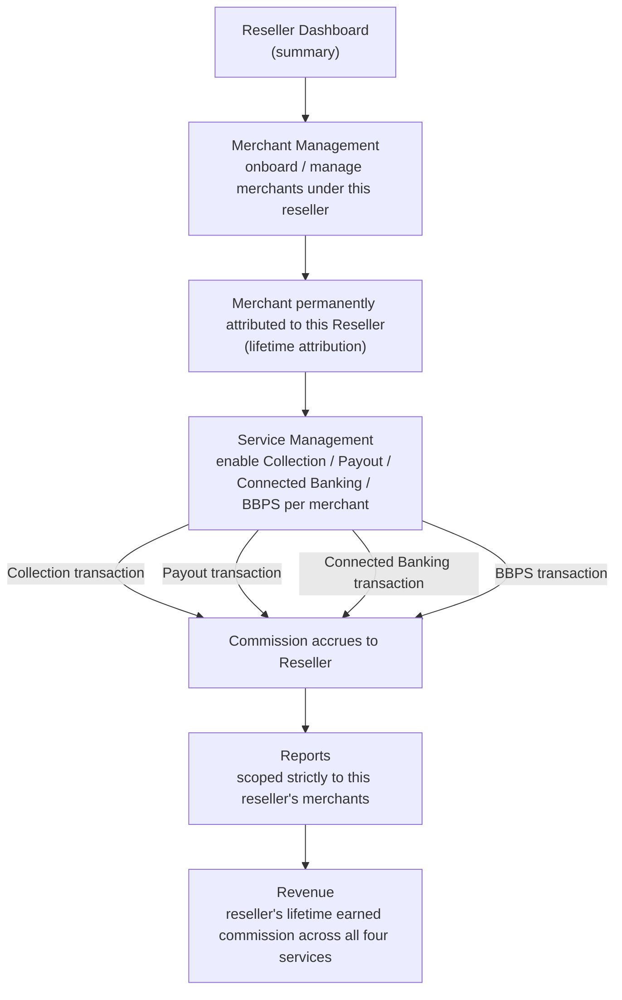

# 🤝 Reseller Management Platform

**A partner/reseller management dashboard for a fintech platform — QA & Automation Portfolio Project**

> This repository documents the QA strategy, test automation, and testing approach applied to a
> **Reseller Dashboard** — the interface resellers/partners use to onboard and manage their own
> book of merchants under a fintech platform, and track the revenue they earn from doing so.
>
> All content here uses **generic/sample data only**. No client names, company names, or
> confidential/production information are included. Dates and timelines are placeholders —
> update `[Timeline]` before publishing.
>
> 📍 **New here?** [`docs/README.md`](./docs/README.md) is a documentation map answering "what is
> this, how does it work, who's involved, what does it depend on" — with a recommended reading
> order through every doc in this repo.

---

## 📖 Table of Contents

1. [What is a Reseller Dashboard?](#-what-is-a-reseller-dashboard)
2. [My Role](#-my-role)
3. [Tech Stack & Tools Used](#-tech-stack--tools-used)
4. [Types of Testing Performed](#-types-of-testing-performed)
5. [How It Works — Business Flow](#-how-it-works--business-flow)
6. [Key Achievements](#-key-achievements)
7. [Automation Approach](#-automation-approach)
8. [Regression Checklist](#-regression-checklist)
9. [Screenshots & Reports](#-screenshots--reports)
10. [Repository Structure](#-repository-structure)

> Deeper dives not covered inline in this README: [Modules, Submodules & Stakeholders](./docs/business-overview.md),
> [Architecture, Flow & Real Sequence Diagrams](./docs/architecture-and-flow.md),
> [Full Tech Stack & Skills Demonstrated](./docs/tech-and-skills.md),
> [Shared Platform Services](./docs/shared-platform-services.md), [UI Consistency](./docs/ui-consistency.md)
> — see [`docs/README.md`](./docs/README.md) for the full map. **Every diagram in this repo is
> drawn in Mermaid and renders natively right here on GitHub — nothing requires visiting another
> site.**

---

## 💡 What is a Reseller Dashboard?

A **Reseller Dashboard** lets a partner organization (a "reseller") onboard and manage their own
portfolio of merchants under a larger fintech platform, in exchange for a share of the revenue
those merchants generate.

If you're new to fintech QA, HR, or any non-technical role: think of it as a franchise model
applied to a payments platform. The platform provides the underlying infrastructure (Collection,
Payout, Connected Banking, BBPS); the reseller brings merchants, manages the relationship, and
earns a **commission on every transaction that merchant makes across all four of those services —
for the lifetime of the relationship**, not a one-time referral bonus. See
[`docs/business-overview.md`](./docs/business-overview.md) section 5 for the full model. This
module is really a **layer of indirection on top of merchant management and commercials**, with
its own dashboard, reporting, and revenue-tracking needs.

### Core Areas

- **Dashboard** — the reseller's summary view: merchants managed, transaction volume, revenue
- **Merchant Management** — onboarding and managing the reseller's own merchant portfolio
- **Service Management** — which platform services (Collection, Payout, Connected Banking,
  BBPS) are enabled for each merchant under this reseller
- **Reports** — activity and performance reporting scoped to the reseller's own merchants only
- **Revenue** — the reseller's earned share of platform commercials
- **Commercials** — the rules governing how that revenue share is calculated

### Who typically interacts with it?

| Role | What they do |
|---|---|
| **Reseller** | Onboards merchants under their own account, manages services, views revenue and reports |
| **Merchant (under a reseller)** | Uses the platform normally — largely unaware of the reseller layer |
| **Platform Admin/Ops** | Approves resellers, configures revenue-share commercials, monitors reseller-level activity |

---

## 👤 My Role

QA Engineer / SDET responsible for the Reseller Dashboard module, owning manual and automated
test coverage across merchant scoping, service management, and revenue reporting accuracy.

- Owned QA strategy for the reseller dashboard → merchant management → service management →
  reports → revenue journey
- Designed and executed automation covering merchant-scoping correctness — the area with the
  highest data-isolation risk in this module
- Performed **API testing** validating that reseller-scoped endpoints never leak data belonging
  to another reseller's merchants
- Validated revenue calculation accuracy against the underlying commercial/settlement data
- Logged, triaged, and tracked defects through their full lifecycle

**Timeline:** `[Add Duration]`

---

## 🛠 Tech Stack & Tools Used

| Category | Tools |
|---|---|
| **UI Automation** | Selenium WebDriver, Java, TestNG |
| **Build Tool** | Maven |
| **API Testing & Automation** | REST Assured, Postman |
| **Performance Testing** | JMeter (concurrent cross-tenant isolation load, not just raw throughput) |
| **CI/CD** | Jenkins |
| **Bug Tracking & Traceability** | JIRA, RTM (Requirement Traceability Matrix — see [`sample-rtm.md`](./sample-rtm.md)) |
| **Version Control** | Git, GitHub |

> Full detail on *why* each tool was chosen, a skill → proof map, and the performance testing
> approach in depth: [`docs/tech-and-skills.md`](./docs/tech-and-skills.md).

---

## 🧪 Types of Testing Performed

- **Functional Testing** — reseller dashboard, merchant management, service toggling
- **Regression Testing** — full onboarding-to-revenue-reporting suite before every release
- **API Testing** — reseller-scoped endpoints, revenue calculation endpoints
- **Data Isolation / Multi-Tenancy Testing** — confirming one reseller can never see another
  reseller's merchants, transactions, or revenue
- **Performance Testing** — tenant-isolation scoping validated under *concurrent* multi-reseller
  load with JMeter, not just sequential one-at-a-time testing (see
  [`docs/tech-and-skills.md`](./docs/tech-and-skills.md) section 5 — this is as much a security
  check as a speed check)
- **Negative Testing** — invalid merchant assignment, service enablement for a non-existent
  merchant, unauthorized cross-reseller access attempts
- **Smoke & Sanity Testing** — post-deployment health checks

---

## 🔄 How It Works — Business Flow

### Reseller Regression Flow



**Key testing principle:** commission attribution is tied to the merchant-reseller relationship,
not a time-bounded contract — it must survive service toggles, staff changes, and merchant
inactivity, and change only via an explicit admin reassignment. See
[`docs/business-overview.md`](./docs/business-overview.md) section 5 for the full rationale and
[`docs/architecture-and-flow.md`](./docs/architecture-and-flow.md) for the full set of sequence
diagrams — including exactly how a cross-reseller data leak and a wrongly-expired attribution
actually happen under the hood.

### Why Data Isolation Is the Highest-Risk Area

Because a Reseller Dashboard is a **multi-tenant view over a shared merchant base**, the single
most damaging class of defect is a reseller seeing (or worse, managing) another reseller's
merchants, transactions, or revenue. Every list, search, and report in this module must be
tested not just for correctness, but for **scoping** — filtered strictly to the logged-in
reseller's own portfolio.

### Admin Functions

- Reseller onboarding & approval
- Revenue-share commercial configuration
- Reseller-level activity monitoring
- Audit logs

---

## 🏆 Key Achievements

- Designed a multi-tenancy-focused test strategy treating merchant-scoping and data isolation as
  the top-priority regression area, ahead of standard functional coverage
- Designed a dedicated lifetime-commission-attribution test category covering all four resold
  services (Collection, Payout, Connected Banking, BBPS), catching a silent attribution-expiry
  defect before release (see [`sample-defect-report.md`](./sample-defect-report.md) Defect #2)
- Validated revenue calculation accuracy end-to-end against underlying commercial/settlement data
- Built automated regression coverage for the reseller-to-revenue-reporting journey
- Logged and tracked defects across scoping, service-management, and revenue-calculation themes

---

## 🤖 Automation Approach

Automation is built with **Selenium WebDriver + Java + TestNG**, using the **Page Object Model**,
backed by REST Assured/Postman API coverage and JMeter for concurrent-isolation performance
testing (see [`docs/tech-and-skills.md`](./docs/tech-and-skills.md) section 5).

### Priority Automated Scenarios

1. Reseller login & dashboard summary accuracy
2. Merchant onboarding under a reseller
3. Service enablement per merchant
4. Cross-reseller data isolation checks (a critical negative-test category)
5. Revenue report accuracy against underlying commercial data
6. Lifetime commission attribution across all four resold services
7. Tenant-isolation scoping under concurrent multi-reseller load (JMeter)

See [`automation/`](./automation) for the framework README and a sample spec file using dummy
data.

---

## ✅ Regression Checklist

- [ ] Reseller Login & Dashboard
- [ ] Merchant Management (Onboard / Update)
- [ ] Service Management (enable/disable per merchant)
- [ ] Reports (scoped correctly to reseller)
- [ ] Revenue Calculation
- [ ] Lifetime Commission Attribution (across Collection/Payout/Connected Banking/BBPS)
- [ ] Commercials / Revenue-Share Configuration
- [ ] Cross-Reseller Data Isolation
- [ ] Permissions / Role-Based Access
- [ ] UI Consistency (status labeling, formatting, terminology, accessibility)

Full checklist with edge cases available in [`regression-checklist.md`](./regression-checklist.md).

---

## 📸 Screenshots & Reports

Sample test execution reports, defect report templates, and a worked Requirement Traceability
Matrix are available in [`regression-execution-summary.md`](./regression-execution-summary.md),
[`sample-defect-report.md`](./sample-defect-report.md), and [`sample-rtm.md`](./sample-rtm.md).

---

## 📁 Repository Structure

> **New here?** Start with [`docs/README.md`](./docs/README.md) — a documentation map that
> answers "what is this, how does it work, who's involved, what does it depend on" and points to
> exactly the right doc for each question.

```
reseller-management-platform/
├── README.md
├── regression-checklist.md          → Full regression suite + edge cases
├── sample-defect-report.md          → Defect theme taxonomy + worked defect examples
├── sample-rtm.md                    → Worked Requirement Traceability Matrix, including real coverage gaps
├── regression-execution-summary.md  → Sample regression test execution report
├── docs/
│   ├── README.md                    → 📍 Documentation map — start here
│   ├── business-overview.md         → What this is, modules/submodules, stakeholders, lifetime-commission model, multi-tenancy risk model
│   ├── architecture-and-flow.md     → Real Mermaid sequence/flow diagrams: onboarding, commission accrual,
│   │                                    the Defect #1 defense-in-depth mechanism, lifetime attribution state model
│   ├── tech-and-skills.md           → Full tech stack (with why), skill → proof map, CI/CD shape, performance depth
│   ├── shared-platform-services.md  → Company-wide services + direct dependency on Collection/Payout/Connected Banking/BBPS
│   └── ui-consistency.md            → Cross-screen UI/UX consistency (status labeling, formatting, a11y)
└── automation/
    ├── README.md                    → Framework setup & structure
    └── SampleResellerTest.java      → Sample Selenium + TestNG test (dummy data)
```

> **Note on structure:** `bug-reports/`, `test-cases/`, and `test-reports/` were originally
> separate folders, each holding a single file — flattened to the repo root since a folder
> holding exactly one file adds navigation overhead without organizing anything. `docs/` and
> `automation/` remain folders because each genuinely groups multiple related files.

## 🤖 Support & Dispute Resolution

Reseller commission disputes and merchant issues arising from any of the four resold services
(Collection, Payout, Connected Banking, BBPS) are handled by the shared
[AI Dispute Resolution Engine](https://github.com/ghanendra-sdet/ai-dispute-resolution-engine)
— a single AI-powered support layer common across Collection, Payout, Connected Banking, BBPS,
Reseller, and YOBO. It resolves ~80% of issues without human involvement, cutting average ticket
resolution time from a 24–72 hour baseline to under 6 hours.
