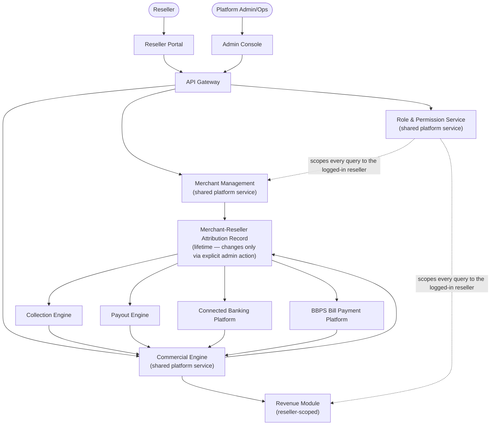
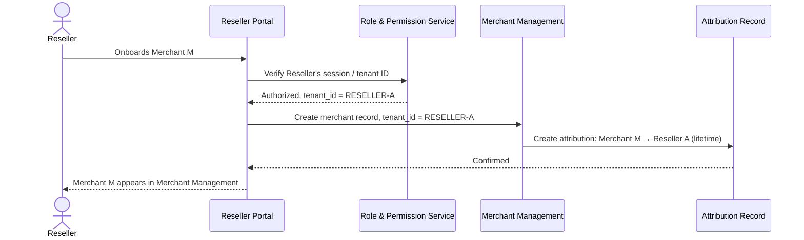
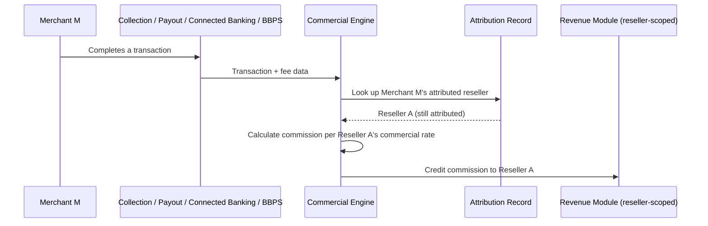
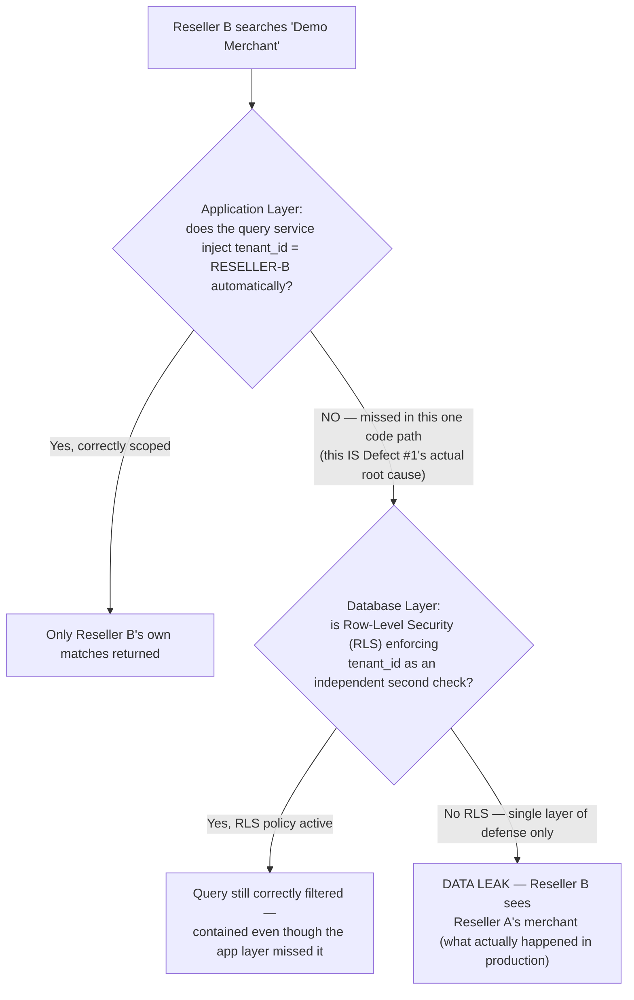
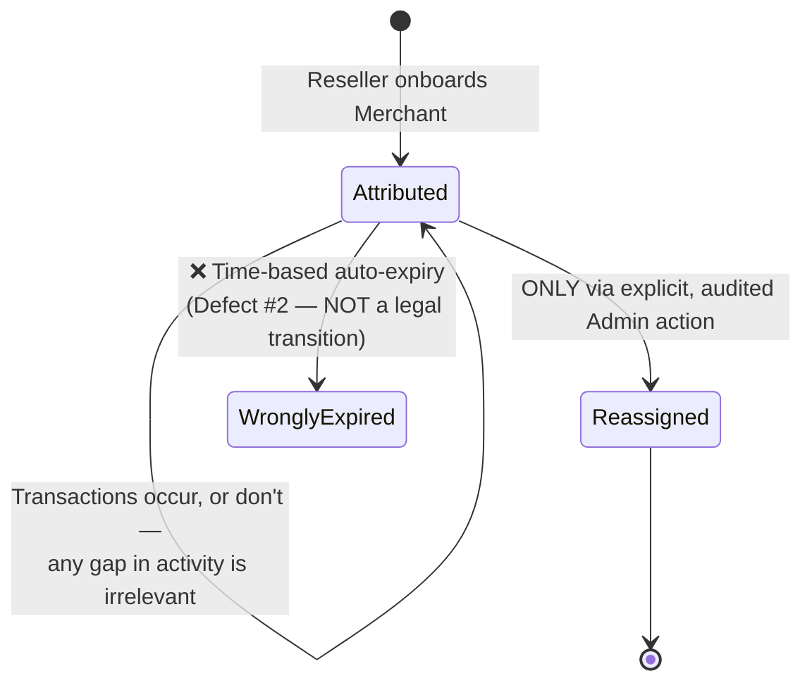

# Reseller Dashboard — Architecture & Flow

> See [`business-overview.md`](./business-overview.md) for why data isolation and lifetime
> commission attribution are this product's two central risks,
> [`tech-and-skills.md`](./tech-and-skills.md) for the tools and skills behind this testing
> approach, and [`README.md`](./README.md) for the full documentation map.
>
> This doc was flagged as a "good candidate for the next iteration" at the bottom of
> `business-overview.md` — this is that iteration. Every diagram below is drawn in
> [Mermaid](https://mermaid.js.org/), which GitHub renders natively in-page — nothing here
> requires opening another site or tool to read it.

## 1. System Architecture — Who Talks to Whom

**Why Role & Permission Service is drawn reaching into both Merchant Management and Revenue
separately, not as one generic arrow:** per
[`shared-platform-services.md`](./shared-platform-services.md), this is the single most
load-bearing shared dependency for the entire product — every cross-reseller isolation guarantee
ultimately rests on *this* service correctly scoping *every* query, in every module, not just the
obvious ones. Section 4 below shows exactly what happens when one code path doesn't go through
it correctly.

## 2. Merchant Onboarding & Attribution Creation

**Key testing principle:** the attribution record created in this flow is the single fact every
later commission calculation depends on (section 3). A bug here doesn't fail loudly — it fails
silently, months later, as a commission that never accrues to anyone.

## 3. Commission Accrual Across All Four Resold Services

**Why this diagram is identical in shape regardless of which of the four services fired it:**
that's deliberate, and it's the actual point — [`business-overview.md`](./business-overview.md)
section 5 is explicit that commission accrues the same way "regardless of which rail the
merchant's transaction routes through." A test suite that only exercises this flow via Collection
and assumes Payout/Connected Banking/BBPS behave identically is trusting an assumption this
diagram makes a required, testable behavior instead — exactly why `TC-016` and `TC-021` in
[`regression-checklist.md`](../regression-checklist.md) exist as explicit, separate cases per
service rather than one generic "commission accrues" test.

## 4. Defense in Depth — The Actual Mechanism Behind Defect #1

[`sample-defect-report.md`](../sample-defect-report.md) Defect #1 (merchant search leaking across
resellers) is this product's worst-case failure mode. Real multi-tenant SaaS systems defend
against exactly this class of bug with **two independent layers**, not one — here's what that
looks like, and exactly which layer this platform's real defect fell through:

**Why this matters more than "add a WHERE clause to the search endpoint":** that fix closes
*this one* code path. The architectural lesson is the left branch of this diagram — relying on
every developer to remember to add tenant scoping to every new query, forever, with nothing
underneath to catch the one time someone forgets. The real-world pattern this platform's
multi-tenancy model should converge toward is **row-level isolation with defense in depth**: the
application layer scopes queries by tenant ID as the first line of defense, and a database-level
mechanism (e.g., PostgreSQL Row-Level Security) enforces the same constraint independently as a
second line — so a single missed `WHERE tenant_id = ?` clause in application code is contained,
not catastrophic. [`sample-defect-report.md`](../sample-defect-report.md)'s suggested fix
("enforce reseller-ID scoping at the query level for every merchant-related endpoint") describes
the left branch; this diagram is the argument for also building the right branch, so the *next*
missed code path doesn't reach production the same way this one did.

## 5. Lifetime Attribution — The State Model, and Why Defect #2 Was an Easy Mistake to Make

**Why this specific bug (a "dormant merchant" job silently clearing attribution) was such a
natural mistake, not a careless one:** most real-world partner/reseller/affiliate programs use a
**time-boxed attribution window** — commonly 30, 60, 90, or occasionally up to 120 days — after
which a referral simply stops counting, specifically to cap how long a partner's claim on a
customer lasts. A "dormant for N days → clear attribution" batch job is the *industry-default*
pattern, not a bug in most systems that use it deliberately.

This platform's commercial model is explicitly **not** that — per
[`business-overview.md`](./business-overview.md) section 5, attribution is lifetime, precisely to
make the partnership more attractive than a typical capped-window referral program. That makes
Defect #2 less a one-off coding error and more a predictable failure mode: **someone (or some
reused library/job template) implemented the pattern that's standard everywhere else**, in a
system that deliberately promises something stronger. The only legal way out of `Attributed` in
the diagram above is the explicit `Reassigned` transition — the same discipline this guide's
sibling repos apply to their own state machines (an "impossible" transition being silently
allowed is exactly how a guarantee quietly stops being true). A regression test for this
isn't just "does commission accrue" — it's "does a long period of merchant inactivity, by itself,
with zero admin action, ever cause attribution to change" (`TC-018` in
[`regression-checklist.md`](../regression-checklist.md)), because that's the specific, plausible
failure this product's business model is most exposed to.

---

**Sources for the real-world architecture patterns referenced above** (used to ground this
document's diagrams in genuine industry practice, not invented mechanics):
[Row-level multi-tenant isolation & RLS defense-in-depth — DEV Community](https://dev.to/whoffagents/multi-tenant-saas-data-isolation-row-level-security-tenant-scoping-and-plan-enforcement-with-1gd4),
[Channel/affiliate attribution windows & lifetime commission tiers — Scaleo](https://www.scaleo.io/blog/channel-partner-commission-structure-a-full-guide-to-fair-revshare-compensation/).
