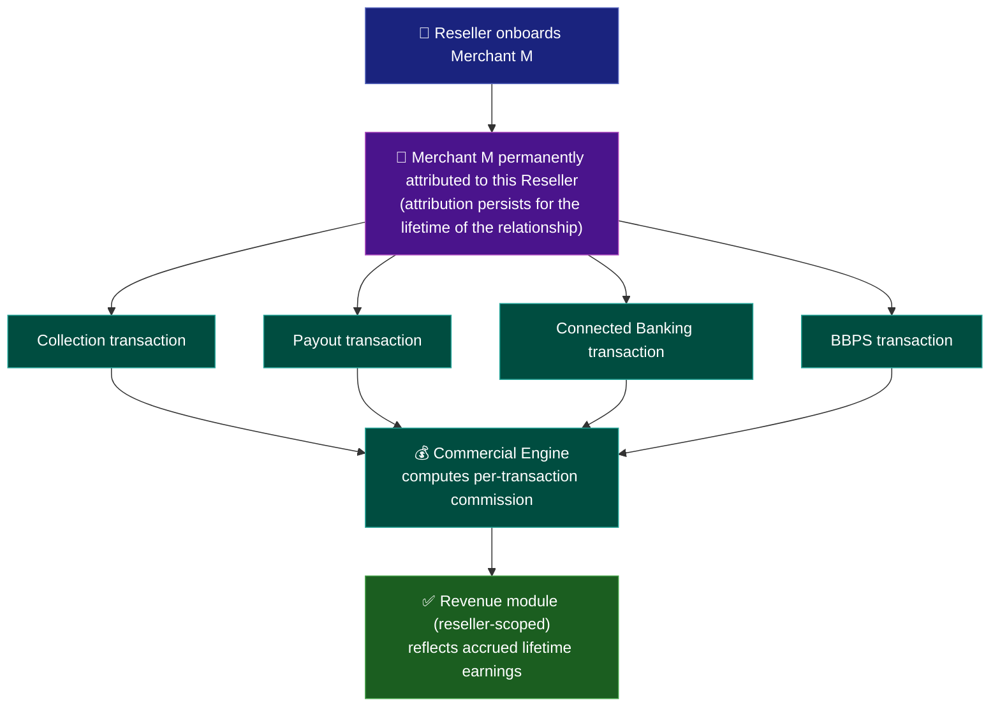

# Reseller Dashboard — Business Overview

> **Start here if you're new to fintech QA, in HR, or from a non-QA technical role.** This
> document explains what a Reseller Dashboard does and why it matters, before you look at any
> test case or code.

## 1. What Problem Does It Solve?

A fintech platform can grow faster by letting partners ("resellers") bring their own merchants
onto the platform, in exchange for a revenue share, rather than the platform having to acquire
every merchant directly. The Reseller Dashboard is what makes that partnership operable: it lets
a reseller manage their own merchant portfolio, control which services are active for each, and
see what they've earned.

## 2. Core Modules and Their Submodules

The bullet list below names *what* exists. This table adds the submodule-level detail a test
plan or automation suite actually needs, plus which skill category (see
[`tech-and-skills.md`](./tech-and-skills.md)) is the primary way each module gets tested.

| Module | Submodules / Key Components | Responsible For | Primarily Tested Via |
|---|---|---|---|
| **Dashboard** | Merchant Count Summary · Transaction Volume Summary · Total Commission Summary | A single-glance, always-correct rollup of the reseller's own portfolio — must reconcile exactly against Revenue's own detailed breakdown (section 4 of [`ui-consistency.md`](./ui-consistency.md)) | UI Automation |
| **Merchant Management** | Merchant Onboarding · Merchant Search/List · Merchant Profile | Bringing a merchant under this reseller and giving the reseller a scoped view of their own portfolio only | UI Automation + Data Isolation Testing |
| **Service Management** | Per-Merchant Service Toggles (Collection / Payout / Connected Banking / BBPS) | Controlling which of the four resold services are active for a given merchant | Functional Testing |
| **Reports** | Activity Reports · Export | Reseller-scoped reporting over their own merchants' activity | API Testing + Data Isolation Testing |
| **Revenue** | Per-Service Commission Breakdown · Lifetime Earnings Total | Showing the reseller exactly what they've earned and from which service | API Testing + Data-Level Validation |
| **Commercials** | Revenue-Share Rate Configuration (Admin-side) | The rules that determine how much commission a reseller earns per transaction — configured by Admin/Ops, consumed by the Commercial Engine (see [`architecture-and-flow.md`](./architecture-and-flow.md) section 3) | Functional Testing (Admin) |
| **Merchant-Reseller Attribution** | Attribution Creation (on onboarding) · Attribution Persistence · Admin Reassignment | The one record every commission calculation depends on — see section 5 below and [`architecture-and-flow.md`](./architecture-and-flow.md) section 5 for its full state model | API Testing + Data-Level Validation |

**Attribution gets its own row, separate from Merchant Management, because it isn't just a field
on the merchant record.** It's the single fact that determines *whose* revenue a transaction
becomes, for the lifetime of the relationship (section 5). Treating it as a first-class module
rather than an implementation detail of onboarding is what makes `TC-016`–`TC-019` in
[`regression-checklist.md`](../regression-checklist.md) a distinct test category instead of a
footnote on the onboarding tests.

## 3. Glossary

| Term | Meaning |
|---|---|
| **Reseller** | A partner organization that onboards and manages its own merchants under the platform |
| **Merchant Scoping** | Ensuring a reseller only ever sees/manages merchants that belong to them |
| **Revenue Share** | The commission a reseller earns from their merchants' commercial activity |
| **Multi-Tenancy** | An architecture where multiple resellers share the same platform but must never see each other's data |
| **Merchant-Reseller Attribution** | The persistent record linking a merchant to the reseller who onboarded them — the basis for lifetime commission (see section 5) |
| **Lifetime Commission** | Commission earned by a reseller on every transaction a referred merchant makes, for as long as the merchant-reseller attribution persists — not a one-time referral bonus |
| **Attribution Window** | In most real-world affiliate/channel programs, a fixed period (commonly 30–120 days) after which a referral stops counting — this platform deliberately has **no** such window; see [`architecture-and-flow.md`](./architecture-and-flow.md) section 5 for why that distinction is exactly what Defect #2 got wrong |
| **Row-Level Isolation** | A multi-tenancy pattern where all tenants share the same database tables, with every row tagged by a tenant ID and every query required to filter on it — the pattern this platform's merchant data follows |
| **Row-Level Security (RLS)** | A database-enforced version of tenant scoping, independent of application code — a second line of defense if an application-layer query ever forgets to filter by tenant (see [`architecture-and-flow.md`](./architecture-and-flow.md) section 4) |

## 4. Why Data Isolation Is the Central Testing Theme

This module is fundamentally a multi-tenant view over a shared merchant base. The single most
damaging class of defect is a reseller seeing or managing another reseller's merchants,
transactions, or revenue — a data-isolation failure, not just a functional bug.

Every list, search, filter, and report in this module needs a **scoping test**, not just a
correctness test: does this feature return only the logged-in reseller's own data, under every
combination of filters, pagination, and search terms?

## 5. Revenue Model: Lifetime Referral Commission Across Four Services

The Reseller Dashboard isn't just a management console. It's the operational layer behind the
platform's referral-and-resell business model. A reseller onboards a merchant once, and from
that point on earns a **commission on every transaction that merchant makes, for the lifetime of
that merchant's relationship with the platform** — not a one-time onboarding bonus, and not
limited to a single product.

This commission accrues across all four merchant-facing services the reseller is authorized to
expose:

- **Collection** — commission on merchant collection/settlement transaction volume
- **Payout** — commission on merchant payout transaction volume
- **Connected Banking** — commission on merchant Connected Banking transaction volume
- **BBPS** — commission on merchant bill-payment transaction volume (see the
  <a href="https://github.com/ghanendra-sdet/bbps-bill-payment-platform" target="_blank" rel="noopener noreferrer">BBPS repository</a>
  for how a merchant's own payment rail choice there works — reseller commission applies
  regardless of which rail the merchant's BBPS transaction routes through)

**Why "lifetime" is the critical word for testing:** the commission entitlement is tied to the
*merchant-to-reseller attribution record*, not to a time-bounded contract. That attribution must
survive indefinitely — across service toggles, reseller staff changes, merchant plan upgrades,
and even periods where the merchant is temporarily inactive — unless an explicit admin action
reassigns or removes it. Any code path that silently expires, resets, or drops that attribution
is a direct revenue-loss defect for the reseller, which makes attribution-persistence testing as
important here as data-isolation testing (see section 4).

## 6. Stakeholders / Involved Parties

| Stakeholder | Role in this module |
|---|---|
| **Reseller** | Onboards merchants, enables services per merchant, views scoped reports and lifetime commission earnings |
| **Merchant (under a reseller)** | Transacts normally across Collection/Payout/Connected Banking/BBPS, generally unaware of the reseller layer or the commission it generates |
| **Platform Admin/Ops** | Approves resellers, configures revenue-share/commission commercials, can reassign merchant-reseller attribution, monitors reseller-level activity |
| **Finance Team** | Reconciles reseller commission payouts against the Commercial Engine's underlying transaction data |
| **Compliance Team** | Reviews reseller onboarding for legitimacy and monitors for commission-attribution abuse (e.g. self-referral, attribution manipulation) |
| **Product Team** | Owns which services are eligible for reseller exposure and how commission rates are structured per service |
| **Support Team** | First point of contact for reseller disputes over commission calculation or attribution; escalates unresolved cases (see section 8) |

## 7. Dependencies

### Direct Product Dependencies (Not "Shared Platform," But Related)

Unlike most shared-platform-service dependencies (see
[`shared-platform-services.md`](./shared-platform-services.md)), the Reseller Dashboard has a
**direct, revenue-bearing dependency on four other products**: it doesn't just reuse their
infrastructure, it resells access to them and earns commission from their transaction volume.

- **Collection Engine** — merchant collection transactions are a commission source
- **Payout Engine** — merchant payout transactions are a commission source
- **Connected Banking Platform** — merchant Connected Banking transactions are a commission source
- **BBPS Bill Payment Platform** — merchant bill-payment transactions are a commission source,
  including internal-rail BBPS payments that themselves route through Payout/Connected Banking

A regression in any of these four products' transaction-logging or status-reporting accuracy
doesn't just affect that product's own users. It can silently under- or over-report the
commission a reseller is owed, making this one of the platform's highest blast-radius dependency
chains.

### Shared Platform Services

See [`shared-platform-services.md`](./shared-platform-services.md) for the full company-wide
service list this product also depends on (Authorization/Role & Permission Service, Commercial
Engine, Merchant Management, Report Engine, etc.).

## 8. Cross-Module Dependencies

- **Merchant Management (platform-wide)** — resellers manage a scoped subset of the same
  underlying merchant records
- **Commercial Engine** — computes both the merchant's fees and the reseller's lifetime
  commission from the same transaction data
- **Collection / Payout / Connected Banking / BBPS** — the four services being resold, toggled
  on/off per merchant, and generating lifetime commission (see section 5)
- **AI Dispute Resolution Engine** — when a reseller disputes a commission calculation, or a
  merchant under a reseller raises an issue with any of the four underlying services, the case is
  ultimately routed to the shared
  <a href="https://github.com/ghanendra-sdet/ai-dispute-resolution-engine" target="_blank" rel="noopener noreferrer">AI Dispute Resolution Engine</a>
  — see [`shared-platform-services.md`](./shared-platform-services.md) for how this ties together
  across products
