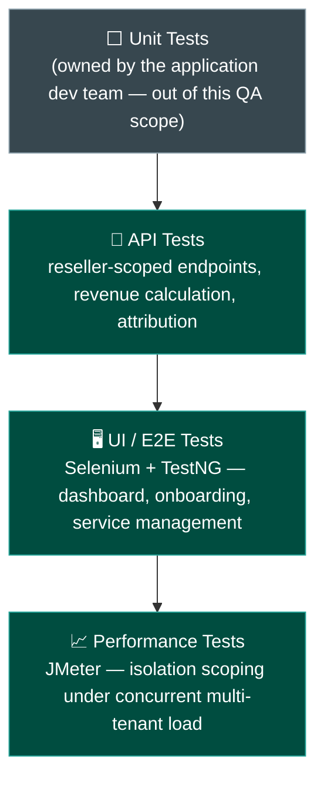
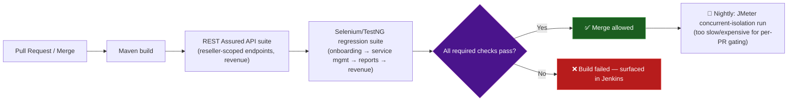

# Reseller Dashboard — Tech Stack & Skills Demonstrated

> Everything in this doc is answerable by reading this repo alone — no need to visit an external
> site to understand what was used or why. See [`business-overview.md`](./business-overview.md)
> for the product/module breakdown and [`architecture-and-flow.md`](./architecture-and-flow.md)
> for how the system actually behaves.

## 1. Full Tech Stack, and Why Each Tool

| Category | Tool | Why This Tool Specifically |
|---|---|---|
| **UI Automation** | Selenium WebDriver + Java + TestNG | TestNG's data-provider pattern is a natural fit for this module's core testing theme: running the same scoping assertion across multiple dummy reseller accounts (see [`../automation/README.md`](../automation/README.md)) |
| **Build Tool** | Maven | Standard JVM build/dependency management, keeping the whole stack — UI automation, API testing, performance testing — on one consistent toolchain (REST Assured and JMeter are both JVM-native too) |
| **API Testing & Automation** | REST Assured, Postman | Validates reseller-scoped endpoints directly, the mechanism behind confirming an API response never leaks another reseller's data, independent of what the UI happens to render |
| **Performance Testing** | JMeter | Chosen to stay in the same JVM/Java ecosystem as the rest of this stack rather than introducing an unrelated language just for load testing — see section 5 below for what it's actually used for in this domain |
| **CI/CD** | Jenkins | Automates the regression suite on a schedule/trigger — see section 4 for the suggested pipeline shape |
| **Bug Tracking** | JIRA | Full defect lifecycle tracking — see [`../sample-defect-report.md`](../sample-defect-report.md) |
| **Version Control** | Git, GitHub | This repo itself; diagrams throughout are Mermaid, which GitHub renders natively with zero extra tooling |

## 2. Skills Demonstrated — Skill → Where to See It

| Skill | Demonstrated By | Where to Look |
|---|---|---|
| **Manual / Functional Testing** | Full onboarding-to-revenue regression suite across all core flows | [`../regression-checklist.md`](../regression-checklist.md) |
| **API Testing** | Reseller-scoped endpoint validation, including negative/cross-tenant-access cases | [`../regression-checklist.md`](../regression-checklist.md) sections 2–3 |
| **UI Automation** | Selenium + TestNG spec covering login, onboarding, and the core cross-reseller isolation assertion | [`../automation/SampleResellerTest.java`](../automation/SampleResellerTest.java) |
| **API Automation** | The same spec's isolation assertion (`resellerBCannotSeeResellerAMerchants`) is the UI-level expression of what an equivalent API-level automated check validates directly against the response payload | [`../automation/SampleResellerTest.java`](../automation/SampleResellerTest.java) |
| **Data Isolation / Multi-Tenancy Testing** | A dedicated, highest-priority test category with a worked critical defect | [`../regression-checklist.md`](../regression-checklist.md) section 2; [`../sample-defect-report.md`](../sample-defect-report.md) Defect #1 |
| **Performance Testing** | JMeter-based concurrent-load testing of tenant-isolation scoping — see section 5 | Section 5 below |
| **Regression Strategy & Prioritization** | A risk-ranked suite with data isolation explicitly marked highest priority, ahead of standard functional coverage | [`../regression-checklist.md`](../regression-checklist.md) |
| **Requirement Traceability (RTM)** | A worked requirement → test case → status mapping | [`../sample-rtm.md`](../sample-rtm.md) |
| **Defect Management & Root-Cause Analysis** | Worked defects identifying the actual mechanism (a missing query-level filter; a dormant-merchant job reimplementing a time-boxed attribution pattern this product deliberately doesn't use) | [`../sample-defect-report.md`](../sample-defect-report.md) |
| **Test Reporting & Metrics** | A structured execution summary with pass/fail breakdown by area | [`../regression-execution-summary.md`](../regression-execution-summary.md) |
| **Technical Documentation & Communication** | This entire `docs/` set | This doc set, start to finish |

## 3. The Testing Pyramid Applied to This Project



For most products, performance testing asks "is it fast enough." For this one, section 5 below
asks a different, higher-stakes question at the same time: does tenant isolation still hold when
many resellers are hitting the system simultaneously, not just one at a time. That's a security
question wearing a performance-test's clothing — worth its own dedicated layer rather than a
generic speed check.

## 4. CI/CD — Suggested Pipeline Shape

> **Note on scope, matching this repo's existing honesty convention** (see
> [`../automation/README.md`](../automation/README.md)): this repo includes one representative
> Selenium/TestNG spec rather than a full framework, to stay focused as a portfolio piece. Jenkins
> is named in the tech stack as the intended CI tool; the pipeline below is the **suggested
> shape** that automation is designed to slot into, not a claim that a live Jenkins instance with
> this exact pipeline is currently running against this repo.



## 5. Performance Testing, in Depth

This platform's performance risk isn't primarily about raw speed. It's about whether its single
most important guarantee — tenant isolation — survives under concurrent, multi-tenant load, not
just when tested one reseller at a time, sequentially, the way most of
[`regression-checklist.md`](../regression-checklist.md) section 2's test cases are written.

| Test Type | What It Targets | Why It Matters Here Specifically |
|---|---|---|
| **Concurrent isolation load test** | Many resellers (e.g., 50+ simulated dummy accounts) querying Merchant Management, Reports, and Revenue **simultaneously** | A scoping bug that only manifests under concurrent access (e.g., a connection-pooled or cached query that occasionally reuses another session's tenant context) would never show up in a test suite that only ever runs one reseller session at a time, sequentially |
| **Load test** | Sustained read traffic against Dashboard/Revenue at a realistic peak (e.g., many resellers checking earnings around a commercial reporting cycle) | Dashboard and Revenue are the screens a reseller checks most often — a slow response here is the first thing a partner notices about the platform's reliability |
| **Spike test** | A sudden surge in merchant onboarding (e.g., a reseller recruitment campaign bringing on many new partners at once) | Onboarding volume is inherently bursty around partner-acquisition pushes, not steady |

**A concrete, illustrative JMeter scenario** — concurrent cross-tenant isolation under load:

```xml
<!-- jmeter/concurrent-isolation-load.jmx — illustrative shape, dummy data only -->
<ThreadGroup>
  <stringProp name="ThreadGroup.num_threads">50</stringProp>   <!-- 50 simulated resellers -->
  <stringProp name="ThreadGroup.ramp_time">10</stringProp>
  <elementProp name="ThreadGroup.main_controller">
    <HTTPSamplerProxy>
      <stringProp name="HTTPSampler.path">/api/merchants?search=Demo</stringProp>
      <!-- Each thread authenticates as a DIFFERENT dummy reseller (RESELLER-001..050) -->
    </HTTPSamplerProxy>
    <ResponseAssertion>
      <!-- Custom assertion: every returned merchant.resellerId MUST equal
           the requesting thread's own authenticated reseller ID -->
    </ResponseAssertion>
  </elementProp>
</ThreadGroup>
```

**What this script actually proves:** not "does the search endpoint respond fast enough" — that's
a secondary benefit — but whether, under 50 simultaneous sessions each authenticated as a
*different* reseller, every single response still contains only that session's own data. Zero
cross-contamination, checked on every response, under the exact kind of concurrent load a
sequential functional test (including the UI automation in
[`SampleResellerTest.java`](../automation/SampleResellerTest.java)) structurally cannot exercise.

## 6. Real-World Grounding — Industry Context

This project's multi-tenancy model and commission structure are deliberately grounded in how
real SaaS and channel-partner platforms work. See
[`architecture-and-flow.md`](./architecture-and-flow.md) sections 4–5 for the full technical and
business reasoning behind row-level isolation with defense in depth, and why this platform's
lifetime attribution model is a deliberate departure from the industry-typical time-boxed
attribution window.

**Sources:**
<a href="https://dev.to/whoffagents/multi-tenant-saas-data-isolation-row-level-security-tenant-scoping-and-plan-enforcement-with-1gd4" target="_blank" rel="noopener noreferrer">Row-level multi-tenant isolation & RLS defense-in-depth — DEV Community</a>,
<a href="https://www.scaleo.io/blog/channel-partner-commission-structure-a-full-guide-to-fair-revshare-compensation/" target="_blank" rel="noopener noreferrer">Channel/affiliate attribution windows & lifetime commission tiers — Scaleo</a>.
